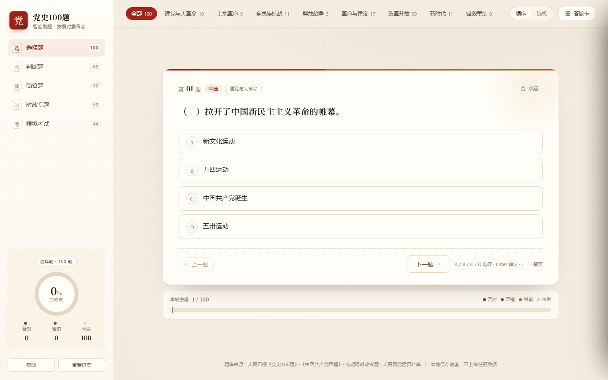
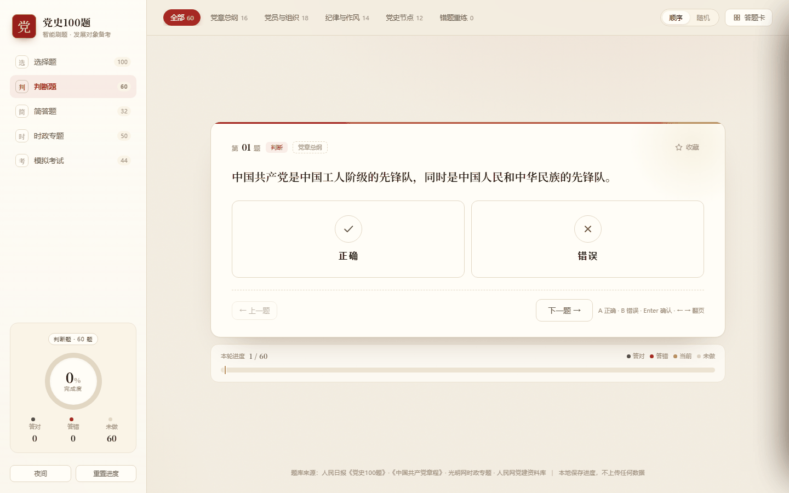
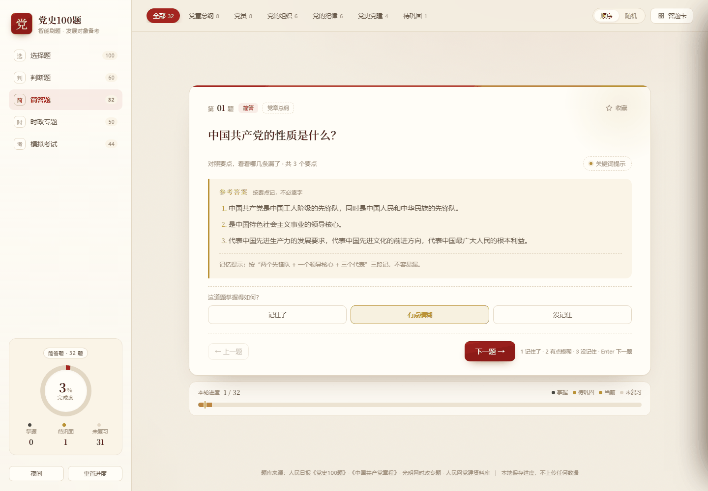
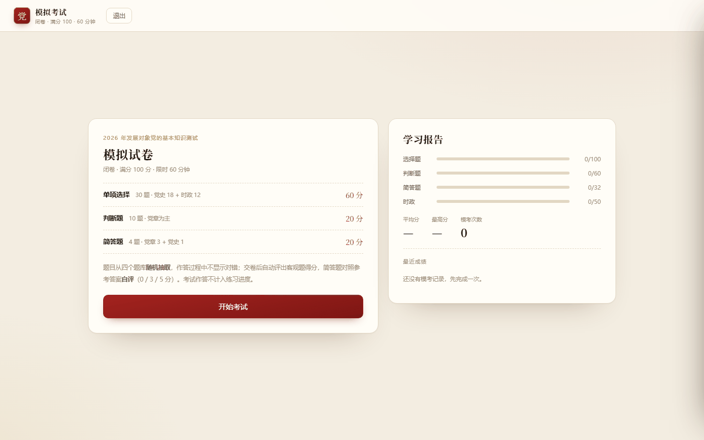
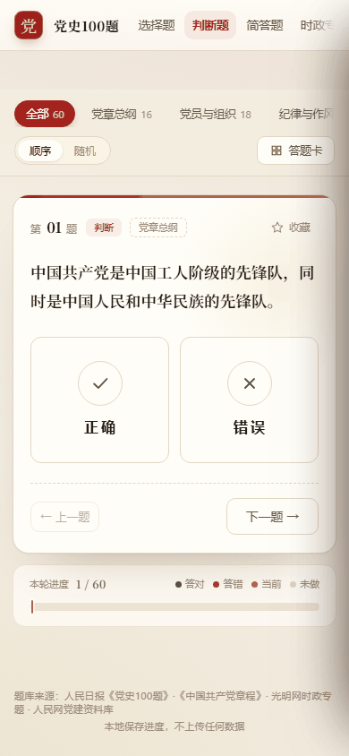

# 党史刷题 · dangshi-quiz

> 党史、党章、时政刷题与模拟考试。纯静态、零依赖、可离线，电脑手机都能用。

一个面向「发展对象 / 入党积极分子」理论考试的自测工具：

**其中共包含了党史100题在内的242 道题、四种题型、一套 100 分模拟卷**。

优点是打开即用，不需要注册。

但是也不做任何数据上传。


示例图：



## 功能

- **四种题型**：选择 100 · 判断 60 · 简答 32 · 时政 50
- **练习方式**：顺序 / 随机 / 章节筛选 / 错题重练 / 收藏 / 答题卡跳转
- **即时反馈**：每题都有解析；判断题的错误项给出更正；时政题标注来源与日期
- **简答背诵**：默背 → 关键词提示 → 参考答案 → 三级自评（记住了 / 有点模糊 / 没记住）
- **模拟考试**：44 题 / 100 分 / 60 分钟，闭卷作答、中途可续考、交卷自动评分、逐题解析、学习报告
- **双主题**：日间纸感 / 夜间
- **纯静态**：无后端、无账号、无追踪，所有数据存在浏览器本地
- **可安装**：PWA，支持添加到主屏幕，离线可用

## 题量

| 模块     | 题量      | 范围                                 |
| ------ | ------- | ---------------------------------- |
| 选择题    | 100     | 《党史100题》全量，七章                      |
| 判断题    | 60      | 党章 48 + 党史 12，正确 / 错误各 30          |
| 简答题    | 32      | 党章 28 + 党史 4，共 80 个得分要点            |
| 时政专题   | 50      | 光明网 2026-02-02 — 09-11 八个专题 + 党建理论 |
| **合计** | **242** |                                    |

模拟卷构成：单项选择 30（党史 18 + 时政 12）· 判断 10 · 简答 4（党章 3 + 党史 1）。

## 界面

<table>  
  <tr>  
    <td width="50%"></td>  
    <td width="50%"></td>  
  </tr>  
  <tr>  
    <td></td>  
    <td></td>  
  </tr>  
</table>

## 快速开始

直接双击 `index.html` 即可。更推荐用静态服务器打开（`file://` 下部分浏览器会禁用 localStorage 与 Service Worker）：

```bash
python -m http.server 8080
# 浏览器访问 http://localhost:8080
```

## 手机使用

- 手机浏览器打开部署地址；
- Chrome：右上角 **⋮ → 添加到主屏幕 / 安装应用**，装完是全屏独立图标；
- **数据各自独立**：每台设备存在自己的浏览器里，互不同步，也不需要登录。

## 数据存储

| 键                | 内容                               |
| ---------------- | -------------------------------- |
| `ds100.v2`       | 练习记录（键形如 `choice:12`）、收藏、主题、出题模式 |
| `ds100.exams.v1` | 模考历史、最近一次试卷与成绩、未完成的考试会话          |

注意：换浏览器、清理缓存、无痕模式都会让数据归零。考试作答**不会**写入练习记录，两套数据彼此隔离。

## 项目结构

```
.
├── index.html              # 单页入口
├── manifest.webmanifest    # PWA 配置
├── sw.js                   # Service Worker（页面网络优先、静态资源缓存优先）
├── assets/
│   ├── css/style.css
│   ├── js/
│   │   ├── core.js         # 判分 / 统计 / 洗牌（纯函数）
│   │   ├── data-history.js # 选择题题库
│   │   ├── data-judge.js   # 判断题题库
│   │   ├── data-short.js   # 简答题题库
│   │   ├── data-current.js # 时政题库
│   │   ├── app.js          # 练习模块：路由、渲染、交互
│   │   └── exam.js         # 模拟考试：组卷、计时、评分、报告
│   └── icon-180/192/512.png
├── tests/                  # 130 项自测
└── docs/screenshots/
```

## 开发与自测

```bash
npm install
npm test
```

130 项断言，覆盖：题库结构校验、判分逻辑、练习模块 DOM 交互、v1 → v2 存储迁移、模拟考试全流程（组卷 / 答题 / 答题卡 / 续考 / 交卷 / 自评 / 历史记录）。

## 题库来源

- **选择题**：人民日报《党史100题》
- **判断题 / 简答题**：《中国共产党章程》（二十大修订）、党史公开史实
- **时政**：光明网时政频道专题（2026-02-02 — 09-11）、中国政府网、央广网、人民网党建资料库

时政题逐题标注「来源：媒体 · 日期」，可直接回查原文。

## 说明

个人备考项目，非官方应用，题目与解析仅供学习参考；题库内容版权归原出处。发现错漏欢迎提 Issue。
